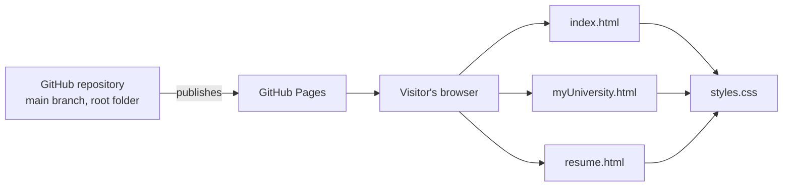
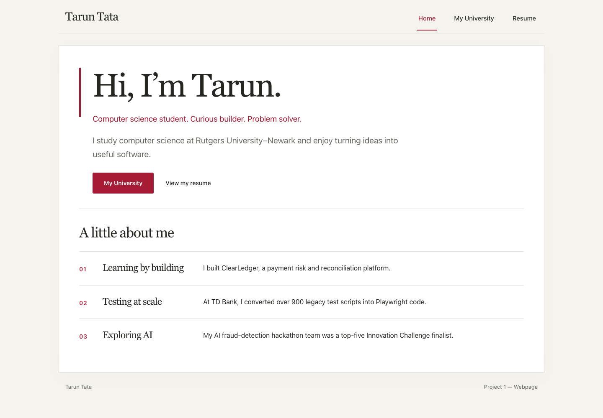
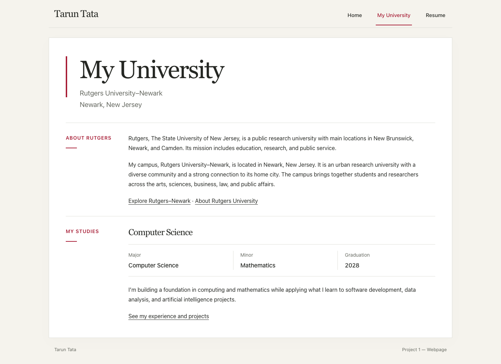
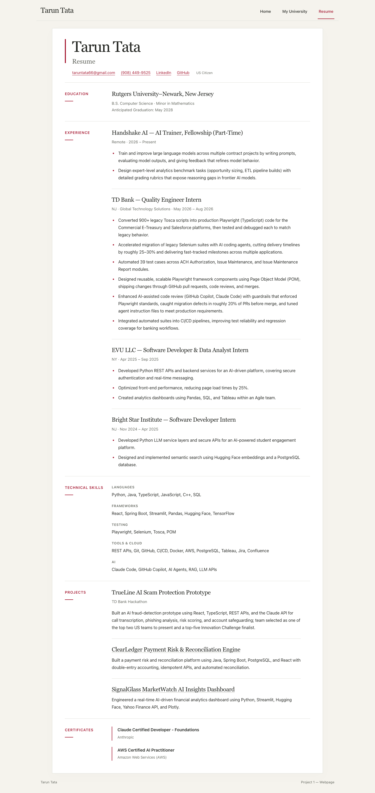
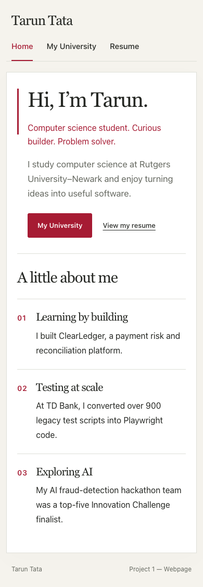
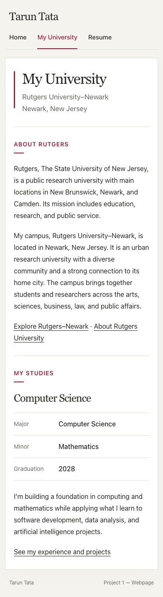
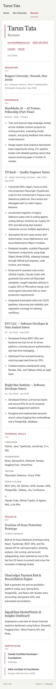

# Project 1 - Webpage

A responsive, three-page personal website built with plain HTML and CSS for a Linux class project.

**Live site:** [Tarun Tata — Project 1](https://TarunT27.github.io/Project-1-Webpage/)

## Project coverage

| Project element | Where it is implemented |
| --- | --- |
| Personal introduction and profile | `index.html` |
| Rutgers University–Newark and studies | `myUniversity.html` |
| Education, experience, skills, projects, and certificates | `resume.html` |
| Shared navigation, responsive layout, focus states, reduced-motion handling, and print styles | `styles.css` |
| Static publishing marker | `.nojekyll` |

All three pages use the same navigation and stylesheet. The pages include semantic headings and sections, a skip-to-content link, and an `aria-current` marker for the active page.

## Architecture



This is a static site: the browser loads an HTML page and its shared CSS file. There is no application server, backend, build step, or runtime dependency.

## Technologies

| Technology | Use |
| --- | --- |
| HTML5 | Page content and structure |
| CSS3 | Shared visual styles, responsive breakpoints, and print formatting |
| Git and GitHub | Source control and repository hosting |
| GitHub Pages | Static website hosting |

Playwright CLI can be used for optional browser checks and screenshots. It is not required to run or publish the website.

## Screenshots

Captured from a local HTTP preview of the current HTML/CSS on **October 28, 2026**, at browser viewports of **1440 × 1000** (desktop) and **390 × 844** (mobile). The same source files are published to GitHub Pages.

### Desktop

**Home**

<a href="output/playwright/home-desktop.png"></a>

**My University**

<a href="output/playwright/university-desktop.png"></a>

<details>
<summary>Resume — full desktop screenshot</summary>

<a href="output/playwright/resume-desktop.png"></a>

</details>

<details>
<summary>Mobile screenshots</summary>

**Home**

<a href="output/playwright/home-mobile.png"></a>

**My University**

<a href="output/playwright/university-mobile.png"></a>

**Resume**

<a href="output/playwright/resume-mobile.png"></a>

</details>

## Run locally on Linux

Prerequisites: Git, Python 3, and a web browser. Python 3's built-in HTTP server is enough; the website has no packages to install.

```bash
git clone https://github.com/TarunT27/Project-1-Webpage.git
cd Project-1-Webpage
python3 -m http.server 8000 --bind 127.0.0.1
```

Open [http://127.0.0.1:8000](http://127.0.0.1:8000) in a browser. Press `Ctrl+C` in the terminal to stop the server.

## GitHub Pages publishing

GitHub Pages is configured to publish the repository's `main` branch from the root folder. The empty `.nojekyll` file tells Pages to serve the static files without running Jekyll. Commit and push updates to `main` to publish them.

## Repository layout

```text
.
├── .nojekyll
├── .gitignore
├── README.md
├── index.html
├── myUniversity.html
├── resume.html
├── styles.css
└── output/
    └── playwright/
        ├── home-desktop.png
        ├── university-desktop.png
        ├── resume-desktop.png
        ├── home-mobile.png
        ├── university-mobile.png
        └── resume-mobile.png
```

## Browser capture notes

The screenshots were captured with **Playwright CLI and Google Chrome on macOS**. The mobile captures use a resized browser viewport; they are not physical-phone tests. The Linux preview instructions use portable Git/Python commands; a Linux machine was not used for these browser captures.

| Check | Result |
| --- | --- |
| Home → My University → Resume → Home | Passed using visible link clicks |
| University content | Major, Minor, and Graduation displayed as three labeled facts: Computer Science, Mathematics, and 2028 |
| Resume content | Education, experience, skills, projects, and both certificates displayed |
| Mobile width at 390px | All three pages had `scrollWidth === innerWidth`; no horizontal overflow |
| Additional responsive checks | All three pages also checked at 320px and 768px widths without horizontal overflow |
| Screenshot files | Six full-page PNGs: three desktop and three mobile |

The preview pages and stylesheet loaded during the Playwright capture, with no JavaScript exceptions. Chrome also requested `/favicon.ico` when opening the site and received a 404; this project does not include a custom favicon. The updated source is checked on the public GitHub Pages URL after deployment.

### Reproduce a capture with Playwright CLI

Optional prerequisites: Node.js/npm and Google Chrome. Run from the repository root:

```bash
mkdir -p output/playwright
npx --yes --package @playwright/cli playwright-cli -s=project1-docs open https://tarunt27.github.io/Project-1-Webpage/ --browser chrome
npx --yes --package @playwright/cli playwright-cli -s=project1-docs resize 1440 1000
npx --yes --package @playwright/cli playwright-cli -s=project1-docs snapshot
npx --yes --package @playwright/cli playwright-cli -s=project1-docs screenshot --filename=output/playwright/home-desktop.png --full-page
npx --yes --package @playwright/cli playwright-cli -s=project1-docs close
```

The screenshot dimensions can be taller than the viewport because each capture includes the full scrollable page. Temporary CLI snapshots and logs in `.playwright-cli/` are ignored by Git; the six screenshots in `output/playwright/` are committed for this README.
